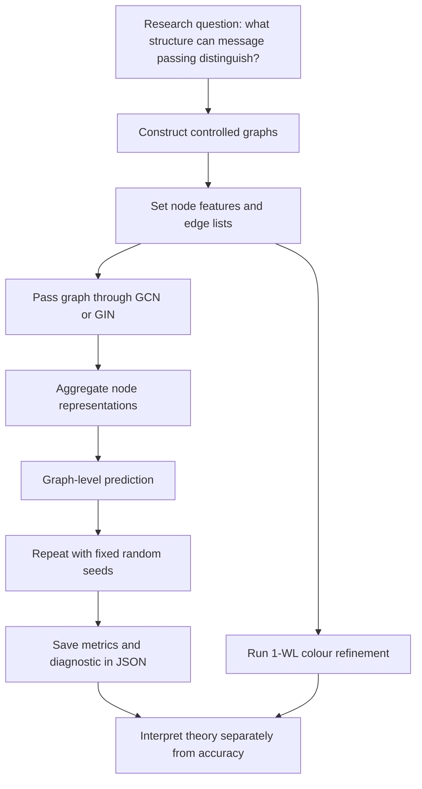
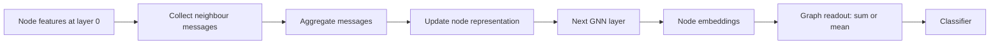
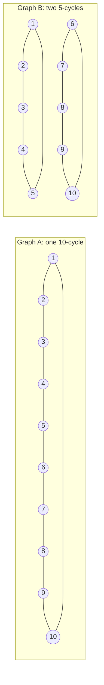
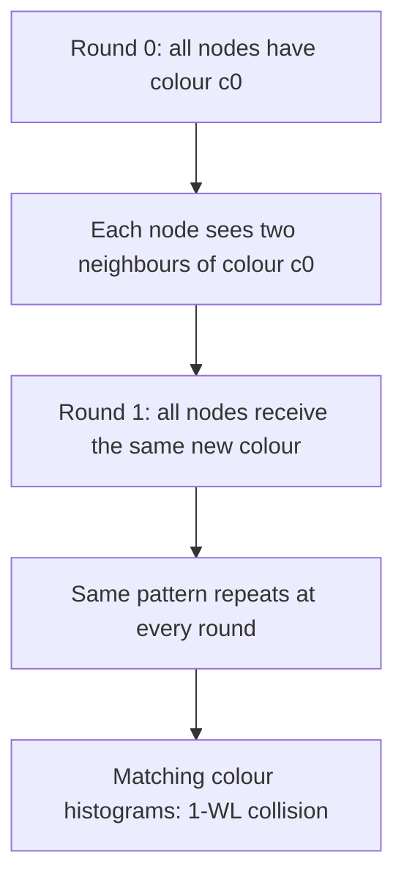
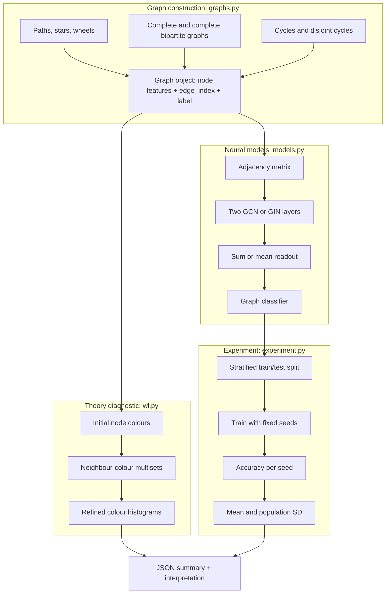
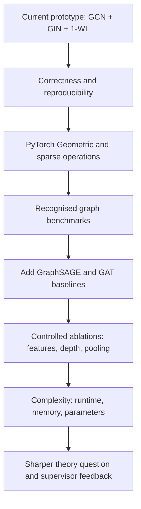

# Visual Guide: Understanding the GNN Expressivity Lab

This guide explains the project from the research question to the code and outputs. It is written to support a first technical discussion with a graph-learning supervisor.

## 1. The project in one sentence

**We compare how two message-passing Graph Neural Networks (GCN and GIN) represent graphs, and use the 1-dimensional Weisfeiler–Leman (1-WL) procedure to reason about structural distinctions that message passing cannot make.**

This is an exploratory implementation and learning project. It is not a new architecture, a new theorem, or a validated benchmark study.

## 2. Why use graphs?

A table describes entities by their attributes. A graph describes entities **and their relationships**.

- Node: an entity (person, molecule, computer, paper, road junction).
- Edge: a relationship between two entities.
- Node feature: information attached to a node.
- Adjacency matrix: a numerical representation of which nodes are connected.

Example: in a citation network, papers are nodes and citation links are directed edges. In this lab, graphs are undirected to keep the first experiments controlled.

## 3. The end-to-end project map

The two analysis tracks are complementary:
- **Theory track:** 1-WL checks whether the controlled pair has matching colour histograms.
- **Learning track:** GCN and GIN are trained on small synthetic graph-family classification tasks.

The classification task is a pipeline sanity check. It does not prove a theoretical expressivity claim.

## 4. What happens inside a GNN?

A message-passing GNN updates each node using its current representation and information from its neighbours.

At layer 1, a node learns from its immediate neighbours. At layer 2, information can travel roughly two hops. More layers expand the receptive field, but they do not automatically make the model able to distinguish every pair of non-isomorphic graphs.

A useful generic update is:

`h_v^(k) = UPDATE(h_v^(k-1), AGGREGATE({h_u^(k-1) : u in N(v)}))`

Here, (h_v^{(k)}) is node (v)'s representation after layer (k), and (N(v)) is its neighbourhood.

## 5. GCN versus GIN

### GCN: normalised aggregation

The implementation adds self-loops, computes node degrees, symmetrically normalises the adjacency matrix, applies a learned linear transformation, and adds a bias.

`H' = D_hat^(-1/2) A_hat D_hat^(-1/2) H W`

- (A_hat = A + I): adjacency matrix plus self-loops.
- (D_hat): diagonal degree matrix of (A_hat).
- (H): node-feature matrix.
- (W): trainable weight matrix.

Intuition: each node receives a degree-normalised mixture of its own and neighbouring features.

### GIN: sum aggregation plus an MLP

`h_v' = MLP((1 + epsilon) h_v + sum_(u in N(v)) h_u)`

- Neighbour messages are summed rather than degree-normalised.
- (epsilon) controls the contribution of the node's own representation.
- The MLP transforms the aggregated representation.

GIN was designed to attain the discriminative power of 1-WL under suitable assumptions, including sufficiently expressive/injective aggregation and readout. This is a theoretical comparison, not a guarantee that every finite trained implementation reaches that power.

| Aspect | GCN | GIN |
|---|---|---|
| Aggregation | Symmetrically degree-normalised | Sum |
| Transformation | Linear layer in each GCN layer | MLP after aggregation |
| Design emphasis | Smooth, normalised neighbourhood mixing | Preserve multiset distinctions |
| Expressivity relationship | Generally weaker than 1-WL | Can match 1-WL under assumptions |
| In this project | Two GCN layers | Two GIN layers with learnable epsilon |

## 6. The central graph-pair example: C10 versus C5 + C5

This is the key mathematical teaching example.

- Graph A is one cycle with ten vertices: (C_{10}).
- Graph B is two separate cycles with five vertices each: (C_5 \sqcup C_5).
- Both graphs have ten vertices.
- Every vertex has degree two.
- Every vertex starts with the same feature.
- They are not isomorphic: Graph A is connected; Graph B has two connected components.

### Visual intuition

### Why does 1-WL fail on this pair?

1-WL starts by assigning colours based on node features. Since all features are identical, all ten vertices receive the same initial colour.
At each round, a node's new colour is determined by its current colour and the multiset of its neighbours' colours. Every node in either graph sees exactly two neighbours with the same colour. Therefore every node remains in one colour class, and the two graphs have matching colour histograms at every round.

**Interpretation:** 1-WL does not distinguish this pair. Standard message-passing GNNs whose discriminative power is bounded by 1-WL inherit this limitation under the same initial-feature setup. More layers do not resolve this particular collision.

Important nuance: this does not mean that GNNs can never use connectivity information in any setting. The result depends on the message-passing framework and the initial features. Adding positional/structural encodings or using higher-order methods changes the setting and should be studied separately.

## 7. What is implemented in the repository?

### Code map

| File | Responsibility | What to inspect |
|---|---|---|
| `graphs.py` | Graph data structure and generators | How nodes, edges, and features are represented |
| `wl.py` | 1-WL colour refinement | How node colours are updated and compared |
| `models.py` | GCN, GIN, pooling, classifier | How the mathematical update becomes PyTorch code |
| `experiment.py` | Training and evaluation | Seeds, split, optimiser, metrics, JSON output |
| `tests/test_core.py` | Unit tests | Graph invariants, WL collision, model output shape |

## 8. Experimental method, step by step

1. **Generate data:** five synthetic graph families, six sizes per family (30 graph instances).
2. **Features:** constant scalar node features. This deliberately prevents degree from being given directly as an input feature.
3. **Split:** stratified 70/30 train/test split for each seed.
4. **Models:** train a two-layer GCN and a two-layer GIN using the same broad protocol.
5. **Optimisation:** Adam, learning rate 0.01, weight decay (10^{-4}), cross-entropy loss, and the configured epoch count.
6. **Repetition:** default seeds 11, 23, and 37.
7. **Metrics:** training accuracy, test accuracy, mean test accuracy, and population standard deviation across seeds.
8. **Separate diagnostic:** compare 1-WL colour histograms for (C_{10}) and (C_5 \sqcup C_5) through five refinement rounds.
9. **Output:** save a machine-readable JSON summary.

### What the output means

| Output field | Meaning | What it does not mean |
|---|---|---|
| Train accuracy | Fit to training graphs | Generalisation to real graph datasets |
| Test accuracy | Held-out synthetic split performance | Proof of theoretical expressivity |
| Mean test accuracy | Average over selected seeds | A population-level estimate |
| Population SD | Variation among these runs | A confidence interval |
| 1-WL equivalent | Same colour histograms through tested rounds | Graph isomorphism in general |

No numeric performance result should be quoted until the experiment has actually been run and the saved JSON has been inspected.

## 9. What should you learn from this project?

After working through the code, you should be able to explain:

1. Why relational data needs graph representations.
2. The difference between node features, edges, adjacency matrices, and graph-level labels.
3. How message passing updates node embeddings.
4. Why GCN normalisation differs from GIN sum aggregation.
5. What 1-WL colour refinement does.
6. Why the (C_{10}) and (C_5 \sqcup C_5) pair is a useful counterexample.
7. Why empirical accuracy and theoretical expressivity are different claims.
8. How to make a small experiment reproducible using fixed seeds, controlled splits, tests, and saved JSON.
9. What the current dense-adjacency implementation cannot yet establish about scalability.

## 10. What is not done yet?

The current implementation is deliberately a first research-learning prototype. It does not yet include:
- recognised benchmark datasets such as MUTAG or PROTEINS;
- PyTorch Geometric or sparse message passing;
- GraphSAGE or GAT;
- systematic parameter-matched ablations;
- runtime, GPU memory, energy, or hardware-efficiency measurements;
- confidence intervals or statistical testing;
- a new theorem or architecture.

## 11. A credible next-stage plan

The order matters: first establish correctness and reproducibility, then scale the implementation and broaden the experiments. Do not jump to efficiency claims before measuring runtime and memory under a documented setup.

## 12. Suggested 60-second explanation

“My project is a small, reproducible study of the expressive limits of message-passing graph neural networks. I implemented GCN and GIN models in PyTorch and a 1-WL colour-refinement diagnostic. The key example compares a single ten-node cycle with two disconnected five-node cycles. Both are 2-regular and use identical initial node features, so 1-WL assigns matching colour histograms even though the graphs are not isomorphic. The project also trains the models on controlled synthetic graph families, repeats runs with fixed seeds, and records accuracy and variability. I treat those metrics as a pipeline check, not as proof of theoretical expressivity. My next steps are to validate the implementation, move to sparse PyG operations, add standard datasets and baselines, and then investigate expressivity and efficiency more systematically.”

## 13. Sparse message passing and architecture comparison

The expanded implementation includes four edge-index-based architectures. Instead of materialising a dense adjacency matrix, each layer gathers source-node messages along edges and accumulates them at destination nodes.

\`\`\`mermaid
flowchart LR
  X[Node features X] --> S[Project node features]
  E[Edge list: source → target] --> M[Gather source messages]
  S --> M
  M --> A[Aggregate at destination]
  A --> U[Update node embeddings]
  U --> R[Graph-level sum or mean pooling]
  R --> C[Graph classifier]
\`\`\`

- **Sparse GCN:** symmetric degree-normalised message aggregation.
- **Sparse GIN:** sum of neighbour embeddings plus a learnable self-term, followed by an MLP.
- **Sparse GraphSAGE:** mean neighbour aggregation combined with a separate self transformation.
- **Sparse GAT:** learned attention weights over incoming neighbours, with a destination-wise softmax.

The GAT implementation is single-head and intentionally readable. It is a reference implementation, not a claim of speed parity with optimised libraries.

## 14. What the expanded experiment measures

The batched experiment compares all four architectures on the same synthetic graph collection and uses the same seeds, hidden width, optimiser, graph pooling, and train/test split procedure. It reports:

- train accuracy and test accuracy for each seed;
- mean and population standard deviation of test accuracy;
- parameter count;
- measured training wall-clock time.

Timing is meaningful only with hardware/software details and identical conditions. Parameter count is not a runtime or memory measurement. A simple wall-clock comparison on a small synthetic dataset is only an initial profiling exercise.

## 15. Optional real-world datasets

The optional PyTorch Geometric extra enables the TU dataset runner. Example:

\`\`\`bash
python -m pip install -e ".[dev,benchmark]"
gnn-benchmark --dataset MUTAG --epochs 100 --seeds 11 23 37 --output results/MUTAG.json
\`\`\`

The runner checks that node features are present and that each class has enough examples for a stratified holdout. It does not claim benchmark-standard results: a publication-quality evaluation should use documented repeated folds, appropriate metrics, and comparable model-selection rules.

## 16. Repeated stratified cross-validation

The optional TU dataset runner uses repeated stratified k-fold evaluation rather than a single train/test split. For each repeat, examples are shuffled within each class and distributed across folds while preserving class proportions. Each fold is held out once; the remaining folds are used for training.

The report includes the mean fold accuracy, sample standard deviation, and a percentile-bootstrap 95% interval over observed fold scores. These are descriptive summaries. For a publication, model selection should be separated from final evaluation and the dataset's accepted benchmark protocol should be followed.
